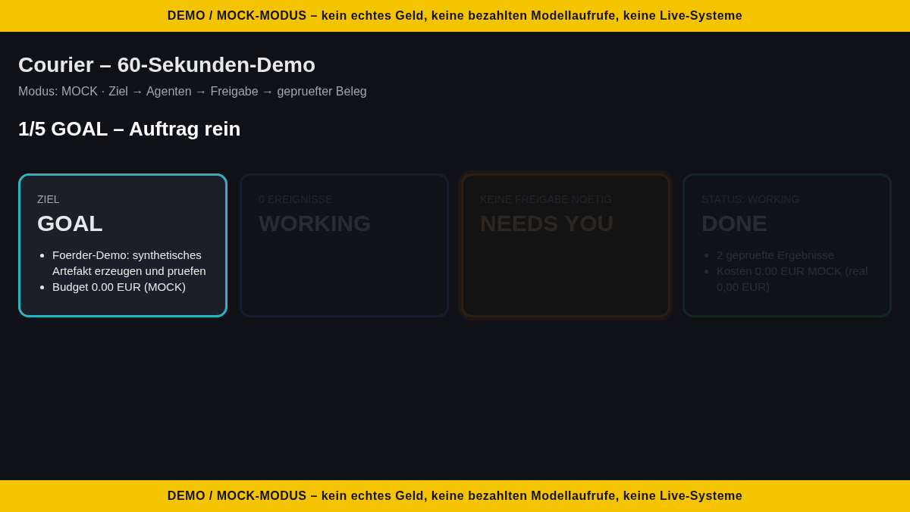

# Courier 60-Sekunden-Demo (MOCK) – Fördertermin 26.10.2026

**Botschaft:** Ziel eingeben → Agenten arbeiten → Mensch gibt Kritisches frei → geprüftes Ergebnis mit Beleg (SHA-256).

> Die Demo läuft ausschließlich im **Mock-Modus** des Orchestrators aus PR #542
> (`courier_orchestrator`, MockWorker + unabhängiger MockPruefer).
> Kein echtes Geld, keine bezahlten Modellaufrufe, kein Netzwerk, keine Live-Systeme.
> Das Terminal zeigt das am Anfang und am Ende als Banner `DEMO / MOCK-MODUS`.

## Starten

Voraussetzung: Python 3.12 (stdlib reicht, keine Pakete).

| System | Befehl (im Repo-Ordner) |
|---|---|
| macOS / Linux | `./scripts/demo_60s.sh` |
| Windows (PowerShell) | `powershell -ExecutionPolicy Bypass -File scripts\demo_60s.ps1` |

Optionen: `--goal "Eigenes Ziel"`, `--interactive` (Freigabe bei NEEDS YOU per Tastatur `j`),
`--fast` (ohne Pausen), `--no-color`, `--out <ordner>`.
Laufzeit mit Pausen: ca. 37 s. Beleg: `demo_out/demo_60s_evidence.json` + `.sha256`
(deterministisch: gleicher Lauf → gleicher Hash).

## Phasen auf dem Bildschirm

1. **GOAL** – Ziel, Mock-Budget, drei Aufgaben (Spezifikation, HTML-Entwurf, Testplan).
2. **WORKING** – Agenten liefern; der unabhängige Prüfer lehnt einen schlechten Entwurf ab, zweiter Versuch geht durch. Nur geprüfte Ergebnisse werden geschrieben.
3. **NEEDS YOU** – T3 will „publication“ auslösen → nur ein Mensch darf das freigeben (in der Demo simuliert, mit `--interactive` live).
4. **DONE** – 3/3 geprüfte Ergebnisse, Mock-Kosten, Pfad zum Beleg und SHA-256.

## Bildschirmaufnahme

**Vorbereitung (beide Systeme):** Terminal ca. **100×30 Zeichen**, Schrift 18–20 pt,
dunkles Theme, Fenster auf **1280×720** bzw. 1920×1080 (16:9). Benachrichtigungen aus
(macOS: Fokus „Nicht stören“, Windows: „Benachrichtigungen nicht stören“). Einmal `--fast`
als Probelauf, dann `clear`.

**macOS:** `Cmd+Shift+5` → „Ausgewählten Bereich aufnehmen“ (oder Fenster) → Rahmen um das
Terminal → *Optionen*: Speicherort Schreibtisch, Mikrofon nach Bedarf → „Aufnehmen“ →
`./scripts/demo_60s.sh` → nach dem DONE-Banner 2 s warten → Stopp-Symbol in der Menüleiste
(oder `Cmd+Ctrl+Esc`). Ergebnis: `.mov`.

**Windows:** Terminal-Fenster aktiv machen → `Win+Alt+R` (Xbox Game Bar, nimmt das aktive
Fenster auf; ggf. erst unter *Einstellungen → Spielen → Captures* aktivieren, `Win+G` öffnet
die Game Bar) → `scripts\demo_60s.ps1` starten → nach DONE `Win+Alt+R` erneut zum Stoppen.
Ergebnis: `.mp4` unter *Videos\Captures*.

**Ablauf (≤ 60 s):** 0–5 s Banner + GOAL · 5–20 s WORKING (Ablehnung + Wiederholung
kommentieren: „Kein Ergebnis zählt ohne unabhängige Prüfung“) · 20–27 s NEEDS YOU
(„Geld, Veröffentlichung, Löschen – entscheidet immer der Mensch“) · 27–37 s DONE + Hash
(„Jedes Ergebnis hat einen Beleg“) · Rest: Puffer/Schlusssatz.

## Test

`python3.12 -m pytest tests/orchestrator/test_demo_60s.py` – prüft Determinismus, alle vier
Phasen, Mock-Banner, Beleg + Hash, Laufzeit < 60 s.

## Statusanzeige (statische HTML, optional)

Eine einzelne HTML-Datei ohne JavaScript, ohne externe Ressourcen, ohne Server und ohne Pakete
(kein Node). Sie zeigt GOAL / WORKING / NEEDS YOU / DONE als große Kacheln; NEEDS YOU ist orange
hervorgehoben mit Grund (z. B. `T3: publication`), oben und unten ein gelbes MOCK-Banner, darunter
der SHA-256 des Belegs.

- Zusammen mit der Demo: `./scripts/demo_60s.sh --html` (Windows: `scripts\demo_60s.ps1 --html`)
  → `demo_out/needs_you_view.html`
- Aus einem vorhandenen Beleg: `python3 scripts/demo_view.py demo_out/demo_60s_evidence.json -o demo_out/needs_you_view.html`
- Öffnen per Doppelklick im Browser. Für die Aufnahme: nach dem DONE im Terminal zur
  Browser-Seite wechseln (macOS `Cmd+Tab`, Windows `Alt+Tab`) und 3–5 s auf der NEEDS-YOU-Kachel bleiben.

### NEEDS-YOU-Quelle

Echte Quelle ist `<home>/run/needs_you.jsonl` (Format wie `courier_worker/queue_feed.py` auf
`feat/blocked-wake-resume`: je Zeile `{"kind":"NEEDS_YOU","mission_id","blocked_event_id","blocker","at","next_action"}`).
Pfad per `--home <home>` oder direkt per `--needs-you <datei>` (bei `demo_60s.py --html` und `demo_view.py`).

- Gültige `NEEDS_YOU`-Zeilen erscheinen in der Kachel mit Grund (`blocker`) und nächster Aktion,
  nach `at` sortiert, Duplikate (`mission_id`+`blocked_event_id`) einmal.
- Erledigte Einträge werden ausgeblendet: eine Zeile `{"kind":"RESOLVED","mission_id","blocked_event_id",…}`
  (von `queue_feed` bei der Wiederaufnahme angehängt) schließt den NEEDS_YOU mit gleicher
  `mission_id` + `blocked_event_id`, unabhängig von der Reihenfolge. Ein neuer Block derselben Mission bleibt offen.
- Kaputte oder fremde Zeilen werden still übersprungen.
- Fehlt die Datei oder hat sie gar keine Einträge → Fallback auf den Demo-Beleg. Sind alle erledigt, zeigt die Kachel grün „0 offen, N erledigt“.
- Über den Kacheln steht immer „NEEDS-YOU-Quelle: …“ (jsonl oder „Demo-Beleg (Fallback …)“).

Beispiel: `./scripts/demo_60s.sh --html --home ~/courier_home`

Tests: `tests/orchestrator/test_demo_view.py`, `tests/orchestrator/test_demo_view_needs_you_source.py`, `tests/orchestrator/test_demo_view_open_only.py`.

## Ein-Befehl-Demo (Tag 2): Auftrag → BLOCKED → NEEDS_YOU → Freigabe → RESOLVED → Beleg

Ein Befehl, unter 60 s (gemessen ca. 35 s mit Pausen), MOCK-Banner am Anfang und Ende:

| System | Befehl |
|---|---|
| macOS / Linux | `./scripts/demo_one.sh` |
| Windows | `powershell -ExecutionPolicy Bypass -File scripts\demo_one.ps1` |

Optionen: `--fast` (ohne Pausen), `--no-color`, `--goal "…"`, `--out <ordner>` (Standard `demo_out/`).

Ablauf über den echten Pfad `courier_worker.queue_feed.feed_once` + `scripts/ledger_v1_bridge.py`
(inkl. RESOLVED + Backfill aus `feat/needs-you-resolved-backfill`, in diesen Branch gemergt), aber nur mit
synthetischen Doubles aus `scripts/demo_one_doubles.py`: Controller im Prozess (kein Netzwerk), Adapter
`synthetic`, Bestätigung durch `person:demo` simuliert, alles in einem frischen Temp-Ordner.

1. **GOAL** – Auftrag, zwei Arbeitspakete WKA → WKB, Goal Contract mit Human Gate.
2. **WORKING** – WKA wird geclaimt und im Ledger BLOCKED (Contract unbestätigt), 0 Controller-Posts.
3. **NEEDS YOU** – `needs_you.jsonl` bekommt `NEEDS_YOU` mit Grund und nächster Aktion; Freigabe simuliert.
4. **WORKING** – genau eine Wiederaufnahme (`queue-resume-…`), `RESOLVED` wird angehängt, WKA und WKB laufen durch.
5. **DONE** – je ein FINAL und ein Controller-Post für WKA/WKB, 0 offene NEEDS_YOU.

Ergebnis in `demo_out/`: `demo_one_view.html` (NEEDS-YOU-Kachel grün: „0 offen, 1 erledigt“),
`demo_one_evidence.json` + `.sha256` (Prüfprotokoll, deterministisch), `needs_you.jsonl`.
Für X: Screenshot der HTML in 1600×900, z. B.
`google-chrome --headless=new --window-size=1600,900 --screenshot=x.png file://$PWD/demo_out/demo_one_view.html`.

Test: `tests/orchestrator/test_demo_one.py` (Determinismus, Phasenreihenfolge, NEEDS_YOU → RESOLVED,
Hash, < 60 s mit Pausen).

## Animierte Vorschau (GIF / MP4)

- GIF: [`docs/demo/demo_one.gif`](demo/demo_one.gif) – 1200×676, 5 Stufen, 14 s, Endlosschleife
- MP4: [`docs/demo/demo_one.mp4`](demo/demo_one.mp4) – gleiche Stufen, 14 s, H.264 (für X/Präsentation)

Stufen: GOAL → WORKING (WKA BLOCKED) → NEEDS YOU (offen, Grund + nächste Aktion) → RESOLVED
(✓ erledigt, Wiederaufnahme) → DONE mit SHA-256. MOCK-Banner in jedem Bild.

Neu erzeugen (reproduzierbar, gleiche GIF-Bytes):
`python3 scripts/make_demo_gif.py` (braucht Pillow und Chrome/Chromium headless; ffmpeg optional für die MP4,
`--no-mp4` überspringt sie). Grundlage ist ein `demo_one.py --fast`-Lauf im Temp-Ordner.
