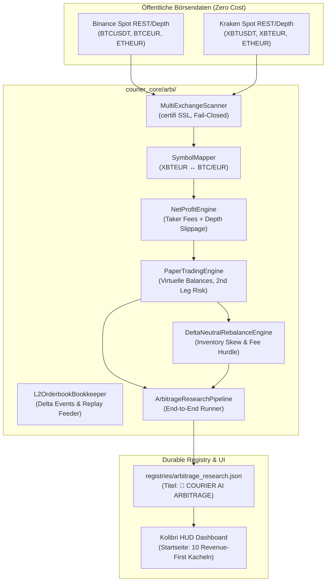

# 👑 Courier Symphony — Arbitrage Research Engine (Binance + Kraken)

**Version:** V45 (Bronze/Consolidated)  
**Datum:** 18.10.2026  
**Status:** IMPLEMENTIERT & VOLLSTÄNDIG GETESTET (20/20 Tests grün)

---

## 1. Systemübersicht & Architektur

Die **Arbitrage Research Engine** ist eine modulare, nachprüfbare Forschungsumgebung für Spreads zwischen **Binance Spot** und **Kraken Spot**. Sie dient der quantitativen Validierung von Marktchancen, ohne reales Kapital zu bewegen.

### Sicherheitsinvariante
- `REAL_TRADES=0`: Keine reale Orderübermittlung an Börsen.
- `WALLET_SIGNING=NO`: Keine privaten Schlüssel oder Wallet-Signaturen.
- `NO_TRADING_API_KEYS=YES`: Ausschließlich öffentliche, unauthentifizierte Marktdaten.
- `AUTONOMOUS_SPEND_LIMIT_EUR=0`: Keine API-Gebühren, kein PAYG-Modell.
- `SINGLE_WRITER=YES`: Keine unautorisierten Git-Pushes oder Merges.



---

## 2. Modulübersicht

| Modul | Pfad | Hauptaufgabe |
| :--- | :--- | :--- |
| **Models** | `courier_core/arbi/models.py` | Datenstrukturen (`OrderbookSnapshot`, `OrderbookLevel`), Symbol-Mapper (`XBTEUR` ↔ `BTC/EUR`), Gebührenpläne (Binance 0.10%, Kraken 0.26%). |
| **Scanner** | `courier_core/arbi/scanner.py` | Unauthentifizierte öffentliche REST-Abfragen für Binance & Kraken; SSL-Validierung via `certifi`. |
| **Net Profit** | `courier_core/arbi/net_profit.py` | Realistische Nettoertragsberechnung: Brutto-Spread minus Taker-Gebühren und Orderbuch-Slippage. Blockiert bei negativem Netto. |
| **Paper Trading** | `courier_core/arbi/paper_trading.py` | Virtuelle Portfolios (52$, 100$, 500$, 1000$ USD), Latenz- & Teilfüllungssimulation, Ausfall der zweiten Order. |
| **Rebalance** | `courier_core/arbi/rebalance.py` | Delta-neutrale Inventar-Überwachung zwischen Börsen; Rebalancing-Kostenhürde (Gewinn muss mind. das 3-fache der Transfergebühr betragen). |
| **Strategies** | `courier_core/arbi/strategies.py` | Dreiecksarbitrage, Cross-Exchange-Vergleiche, Slippage-Stresstests über verschiedene Ordergrößen. |
| **Analyzer** | `courier_core/arbi/analyzer.py` | Deterministische AI-Qualitätsprüfung: Erkennt gekreuzte Orderbücher (`bid >= ask`), veraltete Kurse und Datenanomalien. |
| **Stream** | `courier_core/arbi/stream.py` | L2-Orderbuch-Delta-Bookkeeper und deterministischer Offline-Feeder. |
| **Service** | `courier_core/arbi/service.py` | Orchestrierungs-Pipeline: verbindet Scanner, Kalkulation, Paper-Trading und Registry-Export. |
| **CLI** | `courier_core/arbi/cli.py` | Standalone-Terminal-Interface mit formatierter Konsolenausgabe und `--json`-Export. |

---

## 3. Trennung: Simulation vs. Reale Einnahmen

Im gesamten System gilt das **Wahrheitsprinzip**:
- **Simulierte Ergebnisse:** Werden immer explizit als `SIMULATED (NO REAL TRADES)` deklariert (Cyan- und Gold-Akzente).
- **Tatsächliche Einnahmen:** Bleiben strikt bei `0.00 EUR` (`NO_LIVE_REVENUE_RECORDED`), solange kein echter Bank-/Kontoauszug vorliegt (Grün-Akzent).
- **Fehlende Werte:** Rendern deterministisch als `UNKNOWN / nicht erreichbar`, niemals als erfundene Zahlen.

---

## 4. Testabdeckung (20 Tests)

1. `tests/arbi/test_arbi_engine.py` (9 Tests): Symbol-Mapping, Gebührenüberhang-Blocker, Slippage-Berechnung, Liquiditätsmangel, 2-Wege-Arbitrage Binance ↔ Kraken, virtuelle Bankrolls, Dreiecksarbitrage, gekreuzte Orderbücher.
2. `tests/arbi/test_arbi_service.py` (1 Test): End-to-End Pipeline-Zyklus & Registry-Persistierung.
3. `tests/arbi/test_arbi_cli.py` (2 Tests): CLI-Textausgabe und JSON-Validierung.
4. `tests/arbi/test_arbi_stream.py` (2 Tests): L2-Orderbuch-Delta-Bookkeeper & Feeder.
5. `tests/arbi/test_arbi_rebalance.py` (3 Tests): Delta-neutrales Inventar-Rebalancing & Gebührenhürden.
6. `tests/hub/test_kolibri_arbi_view.py` (3 Tests): DOM-Hierarchie im Kolibri-Dashboard, Latch-Integrität, Trennung von Einnahmen.

Befehl zum Ausführen:
```bash
pytest tests/arbi/ tests/hub/test_kolibri_arbi_view.py
```
