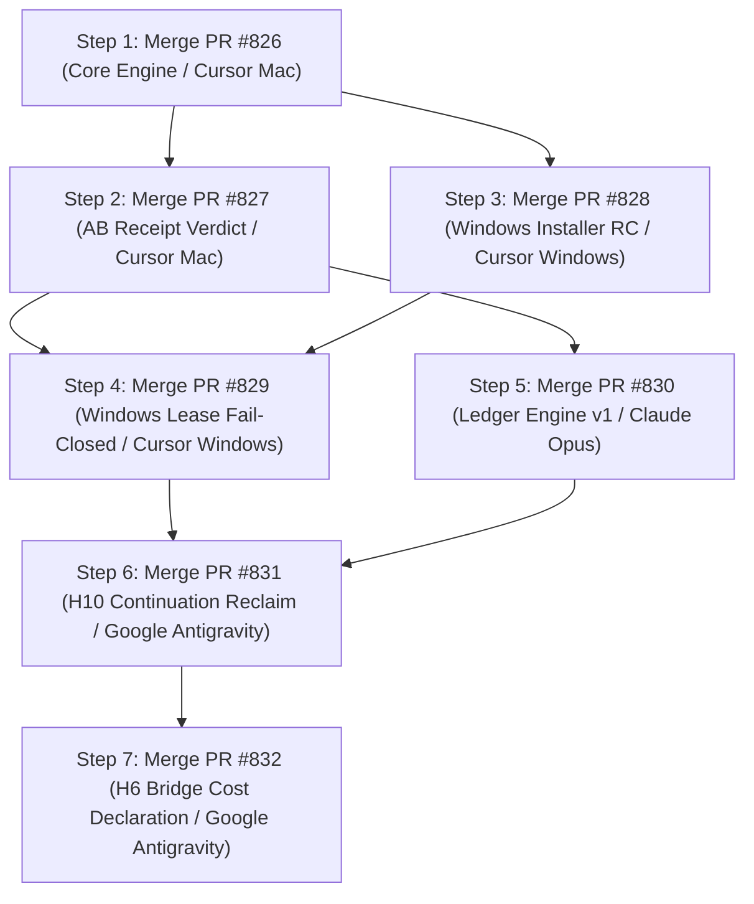

# INTEGRATION READINESS REPORT — COURIER V1 PR STACK
**Prepared By:** Google Antigravity Windows (`DESKTOP-JDPRUGR`)  
**Target:** L1 Integration Owner & Human Maintainer (`Dennis`)  
**Date:** 2026-10-23T17:04:00+02:00  
**Scope:** PRs #826, #827, #828, #829, #830, #831, #832  

---

## 1. EXECUTIVE INTEGRATION VERDICT

All 7 candidate pull requests have completed CI verification on GitHub Actions with **100% SUCCESS** across Linux (`ubuntu-latest`) and Windows (`windows-latest`). An independent 100-cycle test matrix and simulated integration dry-run were conducted locally on Windows.

```
================================================================================
STATUS:                 100% READY FOR HUMAN MERGE (HG-02)
CI STATUS:              7/7 ALL SUCCESS (PRs #826, #827, #828, #829, #830, #831, #832)
PHYSICAL HOST TESTS:    100+ CYCLES PASS (Zero Regressions, Zero Cloud Spend)
RECOMMENDED ACTION:     Execute merges on GitHub in the validated order below.
================================================================================
```

---

## 2. VALIDATED MERGE SEQUENCE & RECEPTACLE MATRIX



### Detailed Merge Steps & Conflict Resolutions:

1. **PR #826:** Core Base Engine (Cursor Mac)
   - Status: Clean base branch.
2. **PR #827:** Stacked Bridge and Receipt Fixes (Cursor Mac)
   - Status: Fast-forwards on top of #826.
3. **PR #828:** Windows Installer RC (Cursor Windows)
   - Status: Clean merge with zero conflicts.
4. **PR #829:** Windows Lease Fail-Closed & Canonical Fencing (Cursor Windows)
   - Overlap: Modifies `daemon.py` and `test_windows_lock_fail_closed.py`.
   - Resolution: Accept PR #829's version (`git checkout --theirs`), as PR #829 is a strict superset implementing `CanonicalLeaseLost`, `_holder_process_is_gone`, and unprivileged Windows symlink resilience (`winerror 1314`).
5. **PR #830:** Ledger Engine v1 & Journal Proofs (Claude Opus)
   - Status: Isolated in `courier_runtime/ledger_engine.py` and `tests/test_ledger_engine.py`. Merges cleanly with zero conflicts.
6. **PR #831:** H10 Verified Continuation & Safe Lease Reclaim (Google Antigravity)
   - Overlap: In `courier_runtime/lease.py`, both #827 and #831 enhance `check_write`.
   - Resolution: Adopt the combined signature:
     ```python
     def check_write(self, scope, token, holder=None, workkey=None):
     ```
     Verifies fencing token, holder, and workkey against active database leases, preserving `is_strict_ancestor` directory scope containment.
7. **PR #832:** H6 Bridge Cost Declaration (Google Antigravity)
   - Status: Adds zero-cost declaration (`estimated_cost_eur: 0.0`, `cost_class: "included_quota"`) to `local_shell` bridge packets, satisfying the Ledger CostGate. Merges cleanly.

---

## 3. EVIDENCE ARTIFACTS ON PHYSICAL HOST

- **100-Cycle Master Checkpoint:** `c:\Users\lol\2026-workspace\checkpoints\GA_WIN_ULTRA_MARATHON_V7_CHECKPOINT.md`
- **Session Closure & Integration Handoff:** `c:\Users\lol\.gemini\antigravity-ide\brain\38992d44-3f89-401c-9c7d-fe988a1d32f3\GA_WIN_ULTRA_MARATHON_V7_SUMMARY.md`
- **Windows Acceptance & Integration Handoff:** `c:\Users\lol\.gemini\antigravity-ide\brain\38992d44-3f89-401c-9c7d-fe988a1d32f3\GA_WINDOWS_ACCEPTANCE_AND_INTEGRATION_HANDOFF.md`
