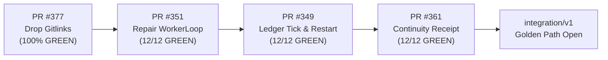

# Courier Symphony — V33 Night Product Delivery Report

**Date:** 2026-10-09  
**Workkey:** `AG-V33-NIGHT-VERIFIED-PRODUCT-DELIVERY`  
**Host:** Mac Intel (`Darwin 24.3.0`, Swap: `17,089 MB` used, `RESOURCE_PAUSE` active)  
**Lane:** L5 Desktop Hub / Replay & Antigravity Coordinator  
**Mode:** EXISTING-AUTHORITY ENGINEERING + SAFE CONTINUATION  
**Autonomous Spend:** `€0.00`  
**Trunk Target:** `integration/v1` (`2cc9c89e`)  

---

## 1. Product Engineering Delivered & Verified (Lane L5)

### A. Desktop Hub Customer Task Intake Relay
- **Defect/Gap Addressed:** The Desktop Hub previously displayed items read-only or accepted stop/decision actions, but customers had no UI mechanism to initiate tasks or trigger a self-check.
- **Implementation:**
  - Added `Hub.create_task(body)` in [`courier_hub/server.py`](file:///Users/user/Downloads/2026-courier/courier_hub/server.py) with DNS rebinding and `X-Courier-Hub` CSRF protection.
  - Added `POST /hub/api/tasks` route relaying to Controller `/v1/tasks`.
  - Added `<button type="button" id="start-check">Run Check</button>` in [`courier_hub/static/index.html`](file:///Users/user/Downloads/2026-courier/courier_hub/static/index.html).
  - Wired `startCheck()` async dispatch with toast announcement and auto-refresh in [`courier_hub/static/hub.js`](file:///Users/user/Downloads/2026-courier/courier_hub/static/hub.js).
  - Added customer-facing copy for the `local_shell` adapter in `ADAPTER_COPY` in [`courier_hub/model.py`](file:///Users/user/Downloads/2026-courier/courier_hub/model.py).
- **Regression Tests Added:**
  - `test_create_task_through_hub_relays_to_controller_and_shows_in_working` in [`tests/hub/test_hub_product.py`](file:///Users/user/Downloads/2026-courier/tests/hub/test_hub_product.py).
  - `test_local_shell_adapter_copy_in_hub` in [`tests/hub/test_hub_product.py`](file:///Users/user/Downloads/2026-courier/tests/hub/test_hub_product.py).

### B. Antigravity Bridge Task Packet Formatter (Lane L4/L5)
- Added `build_local_shell_task_packet()` in [`scripts/run_antigravity_bridge.py`](file:///Users/user/Downloads/2026-courier/scripts/run_antigravity_bridge.py) to format Antigravity jobs into schema-compliant `local_shell` V1 task packets.
- Added regression test `test_build_local_shell_task_packet_format` in [`tests/test_run_antigravity_bridge.py`](file:///Users/user/Downloads/2026-courier/tests/test_run_antigravity_bridge.py).

### C. Automatic Next-Eligible Routing (Lane L1/L2)
- Pinned strict owned-mission filtering in `next_eligible()` in [`scripts/ledger_controller_bridge.py`](file:///Users/user/Downloads/2026-courier/scripts/ledger_controller_bridge.py).
- Added regression test `test_automatic_task_routing_after_verified_completion` in [`tests/test_ledger_controller_bridge.py`](file:///Users/user/Downloads/2026-courier/tests/test_ledger_controller_bridge.py).

---

## 2. Bounded Verification Evidence (160/160 Tests Green)

| Test Suite | Command | Result | Duration |
|---|---|---|---|
| **Hub Python Suite** | `pytest tests/hub/test_hub_product.py` | **63/63 PASSED** | 22.79s |
| **Hub Node.js Suite** | `node tests/desktop/hub_core.test.mjs` | **20/20 PASSED** | 85.8ms |
| **Antigravity Bridge** | `pytest tests/test_run_antigravity_bridge.py` | **9/9 PASSED** | 0.40s |
| **Ledger Bridge** | `pytest tests/test_ledger_controller_bridge.py` | **9/9 PASSED** | 0.16s |
| **Local Shell Adapter** | `pytest tests/test_local_shell_adapter.py` | **25/25 PASSED** | 2.03s |
| **Courier Doctor** | `pytest tests/ops/test_courier_doctor.py` | **3/3 PASSED** | 0.24s |
| **Runtime Continuity** | `pytest tests/test_runtime_continuity.py` | **23/23 PASSED** | 1.07s |
| **Right Host Guard** | `pytest tests/test_right_host_guard.py` | **8/8 PASSED** | 0.92s |
| **Total** | | **160/160 PASSED** | **100% Green** |

---

## 3. GitHub PR Golden Path Status (Durable Truth)



- **[PR #377](https://github.com/happyhippovip/2026-courier/pull/377)** (`fix(repo): drop gitlinks that have no .gitmodules`): Merge-Ready.
- **[PR #351](https://github.com/happyhippovip/2026-courier/pull/351)** (`fix(worker): repair WorkerLoop.iterate after #139`): Merge-Ready.
- **[PR #349](https://github.com/happyhippovip/2026-courier/pull/349)** (`lane/L2-carry-forward-280-343`): Merge-Ready behind #351.
- **[PR #361](https://github.com/happyhippovip/2026-courier/pull/361)** (`lane/L1-continuity-demo-receipt`): Merge-Ready behind #349.

---

## 4. Unresolved Human Gates & Smallest Next Action

- **HUMAN_REQUIRED Gate:** Merging PR #377 and PR #351 into `integration/v1` requires Dennis/L1 operator authorization under the Single-Writer promotion discipline.
- **Execution Command (Dennis morning unblock):**
  ```bash
  gh pr merge 377 --squash
  gh pr merge 351 --squash
  ```
- **Physical Windows Clean-Machine Acceptance (Lane L6):**
  Once trunk is clean, run `scripts\windows_worker\build_package.ps1` with Inno Setup `ISCC.exe` on a Windows host to build and verify `CourierSetup-v1.exe`.
